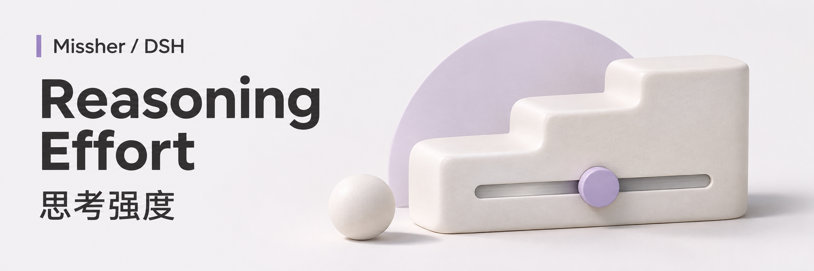
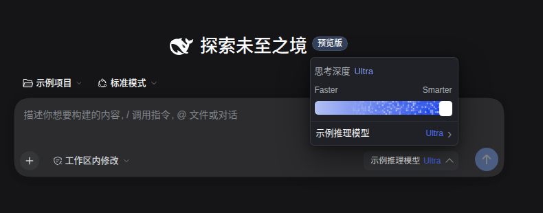
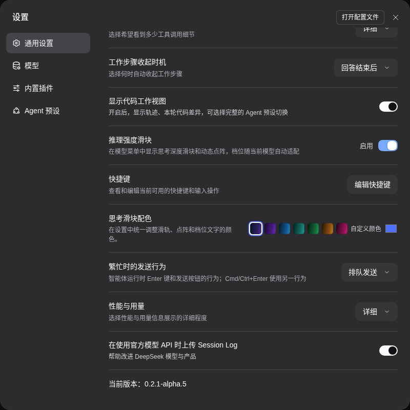

<h1>DSH Reasoning Effort · 思考深度</h1>

根据模型真实支持的档位，直观调整思考深度。

  
  
  

<a href="#功能一览">功能一览</a> · <a href="#快速开始">快速开始</a> · <a href="#使用场景">使用场景</a> · <a href="#常见问题">常见问题</a> · <a href="#详细文档">详细文档</a> · <a href="../README.en.md">English</a>

---

<!-- current-source -->
当前开发源码：**1.0.3** · [分支 `main`](https://github.com/Missher12/Missher-DSH-Reasoning-Effort/tree/main)。安装包以实际 Release 为准。
<!-- /current-source -->

## 功能一览

| 能做什么 | 说明 |
| --- | --- |
| **思考滑块** | 把模型已声明的思考档位映射到直观的深度滑块。 |
| **模型选择** | 在对话入口切换模型，选择失败时保留可用状态。 |
| **自定义模型指引** | 查看缺失配置的说明与片段，复制给 Agent 继续配置。 |
| **原生主题** | 支持深浅主题、中英文与滑块配色，遵循减少动态效果设置。 |

<!-- existing-screenshots -->
## 界面示例

<table><tr><td></td><td></td></tr></table>

来自项目已有文档；截图版本与验证范围见<a href="../README.md">原始说明</a>，点击可放大。
<!-- /existing-screenshots -->

## 快速开始

1. 从 [Releases](https://github.com/Missher12/Missher-DSH-Reasoning-Effort/releases/tag/v1.0.3) 下载对应版本的 `.tgz` 安装包。
2. 在 DSH **插件 → 添加插件** 中选择下载的文件，安装并启用；按宿主提示重新加载或正常重启。
3. 打开对话的模型入口；模型声明至少两个可用档位时，可调整思考滑块。

## 使用前了解

- Ultra 等名称表示模型已声明的档位，滑块不会额外赋予模型能力。
- 每模型档位配置使用支持该扩展的宿主行内入口，插件不另设私有模型设置页。

<!-- readme-expansion -->
## 使用场景

| 遇到的情况 | 怎样使用 |
| --- | --- |
| 不同任务需要不同的模型思考档位 | 在对话入口选择模型已经声明且端点支持的强度。 |
| 自定义模型看不到可选档位 | 查看配置指引与建议片段，核对实际模型条目和服务端文档。 |
| 想快速切换模型，又不希望菜单占据太多空间 | 使用紧凑模型入口、滑块和可展开的说明，并按主题调整配色。 |

## 第一次使用

1. 打开对话中的模型入口，确认当前模型和可用档位。
2. 对已经声明档位的模型选择合适强度；没有声明时先阅读“档位声明指引”。
3. 自定义端点先按供应商实际支持的值配置，再通过真实请求确认参数是否被接受。

### 一个具体例子

“帮我核对当前模型的端点文档和 DSH 配置，只声明服务端实际接受的思考档位；不要因为界面能显示更高档位就推断模型支持它。”

## 常见问题

滑到最高就一定得到更强的推理能力吗？

滑块映射的是模型目录声明的档位。最高位置、Ultra 文案或点阵效果不会给模型增加端点没有提供的能力。

复制给 Agent 会自动修改我的配置吗？

不会。复制的是模型标识、实际配置位置和建议片段，后续修改仍需按用户要求和宿主保存流程完成。

关闭滑块会删除模型配置吗？

关闭入口与删除模型声明是不同操作。模型设置属于宿主，插件也没有独立的聊天或学习数据库。

## 搭配使用

[输出外观](https://github.com/Missher12/Missher-DSH-Output-Renderer) 负责回答排版；[使用统计](https://github.com/Missher12/Missher-DSH-Usage-Statistics) 可以观察已经记录的模型与推理强度使用情况。

## 升级与数据

升级沿用当前模型声明与阅读偏好。能力是否可用，以模型目录、端点文档和实际请求结果共同判断；界面显示成功不等于服务端参数验收。
<!-- /readme-expansion -->

## 详细文档

[项目原说明](../README.md) · [验证记录](../VERIFICATION.md) · [截图来源](../docs/images/README.md) · [许可证](../LICENSE)

原有功能细节、配置、截图与验证记录保留在上述文档中，历史结论按其注明的版本理解。
