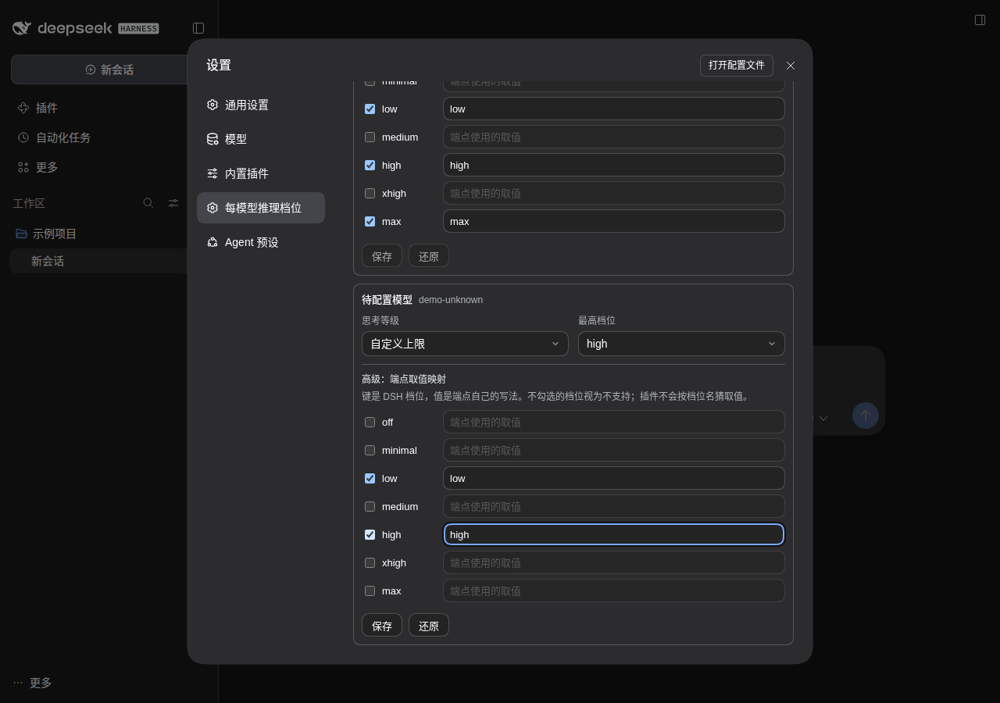

<h1>DSH Reasoning Effort · 思考深度</h1>

根据模型真实支持的档位，直观调整思考深度。

  
  
  

<a href="#功能一览">功能一览</a> · <a href="#快速开始">快速开始</a> · <a href="#visual-guide">图解使用</a> · <a href="#使用场景">使用场景</a> · <a href="#常见问题">常见问题</a> · <a href="#详细文档">详细文档</a> · <a href="../README.en.md">English</a>

---

<!-- current-source -->
当前开发源码：**1.0.7** · [分支 `main`](https://github.com/Missher12/Missher-DSH-Reasoning-Effort/tree/main)。安装包以实际 Release 为准。
<!-- /current-source -->

## 功能一览

| 能做什么 | 说明 |
| --- | --- |
| **思考滑块** | 把模型已声明的思考档位映射到直观的深度滑块。 |
| **模型选择** | 在对话入口切换模型，选择失败时保留可用状态。 |
| **自定义模型指引** | 查看缺失配置的说明与片段，复制给 Agent 继续配置。 |
| **原生主题** | 支持深浅主题、中英文与滑块配色，遵循减少动态效果设置。 |

## 快速开始

1. 从 [Releases](https://github.com/Missher12/Missher-DSH-Reasoning-Effort/releases/tag/v1.0.7) 下载对应版本的 `.tgz` 安装包。
2. 在 DSH **插件 → 添加插件** 中选择下载的文件，安装并启用；按宿主提示重新加载或正常重启。
3. 打开对话的模型入口；模型声明至少两个可用档位时，可调整思考滑块。

<!-- visual-guide -->

## 图解使用流程

模型先声明支持哪些档位，界面再给出对应的选择。

[查看完整流程图](../docs/images/workflow-guide.svg)

| 步骤 | 怎样操作 | 需要留意 |
| --- | --- | --- |
| 1. 选择模型 | 从行内模型选择入口切换到需要使用的模型。 | 切换失败时保留可用状态，不把失败当成已经切换。 |
| 2. 查看档位 | 读取模型能力中声明的思考等级。 | 没有配置或模型不支持时，不能靠显示一个滑块制造能力。 |
| 3. 设置强度 | 选择该模型支持的档位，再发起后续请求。 | 档位表达请求偏好；更高档不保证每个问题都更快或更准确。 |
| 4. 处理自定义模型 | 按设置中的引导补充模型能力配置，必要时复制配置片段。 | 使用当前模型的真实能力声明，不能照搬其他模型的参数。 |

### 试一次

> 给一个支持思考档位的模型设置适合复杂分析的等级，再提出实际问题；短任务可调回较轻档位。若没有档位，先检查模型设置。

使用后可以这样核对：

- 模型名称和可选等级对应。
- 切换或保存失败有可见提示，当前可用选择没有被清空。
- 它控制模型请求的思考等级，不负责展示隐藏的思考过程。

### 设置怎么选

| 项目 | 建议 |
| --- | --- |
| 支持等级 | 以当前模型声明为准；不同模型的数量和名称可以不同。 |
| 自定义模型 | 先补全能力配置，再使用控件；配置提示不能视为服务端已支持。 |
| 主题与操作 | 沿用宿主主题、键盘操作及减少动态效果偏好。 |

<!-- existing-screenshots -->
### 界面示例

<table><tr><td></td><td></td></tr></table>

来自项目已有文档；截图版本与验证范围见<a href="../README.md">原始说明</a>，点击可放大。
<!-- /existing-screenshots -->

已有图片展示行内滑块与设置入口。下面补充模型设置参考，实际可选档位以当前模型声明为准。

模型设置入口的已有 rc.4 界面参考，用于理解能力配置位置；不是所有模型的通用参数模板。
<!-- /visual-guide -->

## 使用前了解

- 滑块保留选中的那一格。即使两格提交相同的模型档位，重开时也能回到原来的位置。
- 每模型档位配置使用支持该扩展的宿主行内入口，插件不另设私有模型设置页。

<!-- readme-expansion -->
## 使用场景

| 遇到的情况 | 怎样使用 |
| --- | --- |
| 不同任务需要不同的模型思考档位 | 在对话入口选择模型已经声明且端点支持的强度。 |
| 自定义模型看不到可选档位 | 查看配置指引与建议片段，核对实际模型条目和服务端文档。 |
| 想快速切换模型，又不希望菜单占据太多空间 | 使用紧凑模型入口、滑块和可展开的说明，并按主题调整配色。 |

## 常见问题

滑到最高就一定得到更强的推理能力吗？

滑块映射的是模型目录声明的档位。最高位置、Ultra 文案或点阵效果不会给模型增加端点没有提供的能力。

复制给 Agent 会自动修改我的配置吗？

不会。复制的是模型标识、实际配置位置和建议片段，后续修改仍需按用户要求和宿主保存流程完成。

关闭滑块会删除模型配置吗？

关闭入口与删除模型声明是不同操作。模型设置属于宿主，插件也没有独立的聊天或学习数据库。

## 搭配使用

[输出外观](https://github.com/Missher12/Missher-DSH-Output-Renderer) 负责回答排版；[使用统计](https://github.com/Missher12/Missher-DSH-Usage-Statistics) 可以观察已经记录的模型与推理强度使用情况。

## 升级与数据

升级沿用当前模型声明与阅读偏好。能力是否可用，以模型目录、端点文档和实际请求结果共同判断；界面显示成功不等于服务端参数验收。
<!-- /readme-expansion -->

## 详细文档

[项目原说明](../README.md) · [验证记录](../VERIFICATION.md) · [截图来源](../docs/images/README.md) · [许可证](../LICENSE)

原有功能细节、配置、截图与验证记录保留在上述文档中，历史结论按其注明的版本理解。
