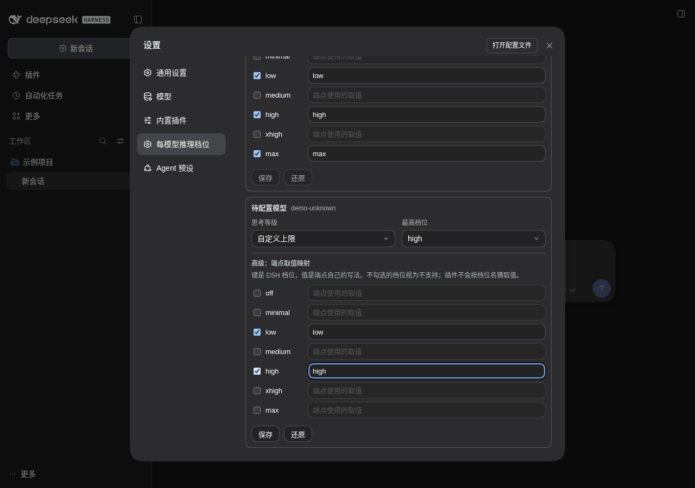
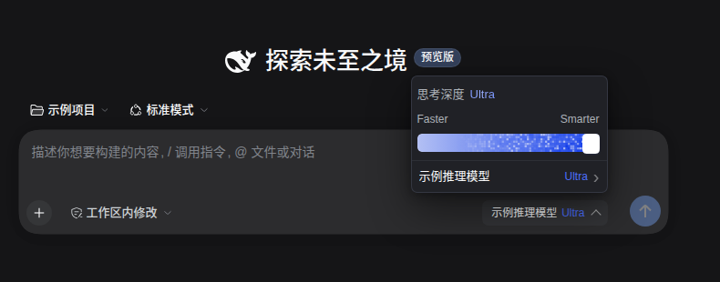
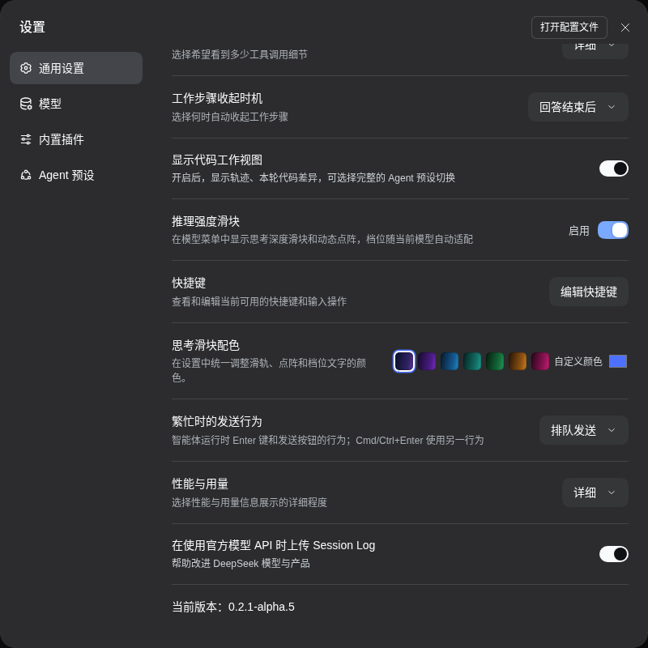

# Missher DSH Reasoning Effort

Model selection, a thinking-depth slider mapped to declared model capabilities, and configuration guidance for custom models. Package: `@missher/dsh-reasoning-effort`; current source is the `0.7.7` candidate (**not yet published**); the latest published release is `0.7.6`.

[中文](README.md) · [Desktop downloads](https://github.com/Missher12/Missher-DeepseekHarness-Desktop) · [Source](https://github.com/Missher12/Missher-DSH-Reasoning-Effort) · [Issues](https://github.com/Missher12/Missher-DSH-Reasoning-Effort/issues)

## Features

- Choose a model and adjust thinking depth from the conversation model control. Displayed steps map to the model's declared levels; failed selections roll back. The slider requires at least two available levels.
- Preserve the selected single-card design, white thumb, eight-row particle field at the highest level, colour gradient, light/dark themes and Chinese/English UI. Colours live in General Settings. Reduced-motion mode shows a stable frame; hidden pages pause particles.
- For custom models with missing or mismatched declarations, show configuration guidance and Copy for your agent. The heading stays fully visible, copy buttons have equal dimensions, and the body scrolls independently of the actions; very short menus scroll the body and actions together below the heading. Open menus follow the Host layout during window resizing to stay within the viewport.
- **Per-model reasoning levels have two entry points over one configuration:** when the companion Missher Desktop Models module declares `settings.models.model-fields`, reasoning mode and maximum level appear beside the model card and share its save action. When the Host does not declare that slot (official DSH `0.2.1-rc.4` does not), the same controls appear on the plugin's own "Per-model reasoning levels" settings page and write the same Host `reasoningEfforts` leaf through the public `configForms` queue. A later declaration moves them back inline, so the two entries never coexist. Advanced mode takes the endpoint's wire values explicitly; the plugin never derives a wire value from a level name. This plugin does not add text/image capabilities or maintain another model catalog.

## Host requirements and verification scope

Compatibility follows the interfaces available at runtime. The client needs the model directory, session selection, Slots, Locale and settings services. The Host requires `settings.describe`, `settings.prepareDocument` and `llm.resolveModelInfo`; missing members produce specific diagnostics. The settings namespace and guidance channel are optional capabilities. The channel needs both route registration and request validation.

DSH peers remain `*`; Cordis accepts `^4.0.4 || ^4.0.5-alpha.1`, Schemastery `^3.18.4 || ^3.18.5-alpha.1`, and React `^18.2.0`. The development SDK remains `0.2.0-rc.2`. These ranges allow installation; verified coverage is narrower:

| Host | 0.7.6 evidence |
| --- | --- |
| Official npm DSH `0.2.1-alpha.5` / Cordis `4.0.5` | Isolated Web profile, actual Loader, request validation, read-only guidance, served client and unloading; real-browser slider, clipboard, palette and viewport checks with synthetic models. |
| Missher community extensions `0.2.0-rc.2` / `0.2.1-alpha.2` | Actual isolated Host boot, Loader, guidance, request validation, client-byte and unload checks. These are not pristine official distributions. |
| Native macOS/Windows Desktop and other Host versions | No new native acceptance in this delivery. Historical evidence and detailed limits are in [VERIFICATION.md](VERIFICATION.md). |

The model-row extension is optional. Registration follows its declaration and removal while the slider remains available. This Bundle embeds no Host modules. These checks made no inference calls to real model endpoints.

`0.7.7` adds only the settings-page entry point for hosts that do not declare `settings.models.model-fields`. It writes the same Host `reasoningEfforts` configuration: one exact leaf, other fields preserved; the Host's public `settingsSchema` resolves that leaf and validates the value before anything is sent; a duplicated user model id, an unconfirmed address or a read-only document stays read-only. A built-in model uses `modelOverrides` only when the route declares no models list and the id belongs to the installed catalog, and its inherited value is read from the base layer.

`0.7.7` has passed type checks, builds, 103 model-reasoning behaviour checks and 29 palette browser checks. An isolated official npm DSH `0.2.1-rc.4` Web profile exercised the settings page, explicit mappings, invalid-save blocking, persistence after reopening and refresh, preservation of neighboring models, and draft conflicts across two Host changes. Normal-width and 390-pixel layouts were measured and their actual screenshots inspected after the corrections.

This is combined coverage across stages. The final CSS changes received affected client type, build, load and layout checks; the 103 logic checks, 29 palette checks, save/conflict behaviour, unchanged backend, bilingual copy and first five logic suites reuse earlier passing results from this candidate. They were not all rerun in one window. Another 50 lifecycle checks used the actual rc.4 Cordis/module system/SlotRegistry and candidate factory, with controlled declaration changes and non-slot services; they do not establish end-to-end inline saving on a community Host.

**0.7.7 remains an unpublished candidate, not installed in the daily profile.** These Web checks used synthetic models and do not certify native Electron, macOS, Windows or real model endpoints. The table above retains the separate historical 0.7.6 scope. See [VERIFICATION.md](VERIFICATION.md) for retained failures, reused evidence and limits.

## Screenshots

The `0.7.7` per-model settings page below is an actual capture from an isolated official DSH `0.2.1-rc.4` Web profile with synthetic models and settings. It is not a native Electron screenshot.



The two historical 0.7.6 captures below show an isolated official DSH `0.2.1-alpha.5` Web profile, also using synthetic models and settings. See [provenance for all three images](docs/images/README.md).





## Install a fixed version

Distribution uses built tarballs in [GitHub Releases](https://github.com/Missher12/Missher-DSH-Reasoning-Effort/releases); **this scoped package is not published to npm**. Select the target version and its accompanying SHA256 checksum. The example below pins `0.7.6`.

**Desktop:** paste this fixed URL into Plugins → Add plugin. Check the version, enabled state and loading errors, then reload or restart as requested by the Host. Desktop owns its profile; a standalone CLI `web` profile does not update Desktop.

```text
https://github.com/Missher12/Missher-DSH-Reasoning-Effort/releases/download/v0.7.6/missher-dsh-reasoning-effort-0.7.6.tgz
```

**Standalone Web/CLI profiles:** with DSH CLI installed:

```sh
dsh plugin --profile web add https://github.com/Missher12/Missher-DSH-Reasoning-Effort/releases/download/v0.7.6/missher-dsh-reasoning-effort-0.7.6.tgz
dsh --profile web --dump-config
```

Replace `web` with your actual Web/CLI profile. The composition should include `id: reasoning-effort` and `name: '@missher/dsh-reasoning-effort'`; configuration presence alone does not prove active loading. Start or restart that profile and check its conversation model control. Do not enable the upstream package alongside this customization: their guidance channel and settings keys overlap.

Keep the previous tarball and current profile configuration before updating. Tarballs are fixed snapshots; pulling Git does not update an installed plugin.

## Usage and capability semantics

The slider reads `reasoning.efforts` from the model directory. Maximum supported level, default level and current conversation choice are distinct. The Ultra label and top-level particles do not grant additional capability. Lowering and raising the configuration limit preserves existing draft mappings; sparse levels retain their actual endpoint values, and unrecognized mappings keep automatic mode available.

For a custom model without declarations, open View level declaration guidance. Follow the displayed configuration path and endpoint documentation to update the appropriate `llm-pi-ai` model entry, for example:

```yaml
reasoningEfforts:
  low: "<lower effort value accepted by the endpoint>"
  high: "<higher effort value accepted by the endpoint>"
```

Unlisted levels are not declared as selectable. `reasoningEfforts: false` supplies no selectable effort levels; it does not guarantee that the endpoint performs no internal reasoning. Use `modelOverrides` for a single existing catalog model; a nonempty `models` list can replace the provider catalog.

Add `compat` fields such as `thinkingFormat`, `supportsReasoningEffort`, `supportsDeveloperRole` or `requiresReasoningContentOnAssistantMessages` only when endpoint documentation or a specific error supports them. Built-in knowledge is advisory, not a vendor guarantee. A visible slider proves directory/UI recognition, not server acceptance of the parameters.

Copy for your agent places the model identity, real configuration path, diagnosis and starting snippet on the clipboard. It does not call another agent or apply changes automatically. Host guidance is read-only; inline model edits use the Host's existing save action. Custom `entries` can extend the knowledge base; see the [English configuration tutorial](src/client/agent-tutorial.en.md) and [Host configuration](src/index.ts).

## Disable, uninstall and retained data

- To restore the native model selector temporarily, turn off Reasoning effort slider in General Settings. This switch controls the slider entry; disable the Bundle in the plugin manager to stop the whole plugin.
- On Desktop, uninstall `@missher/dsh-reasoning-effort` through the same plugin manager. For a Web/CLI profile, use the exact scoped package name below, then restart or refresh the Host.

```sh
dsh plugin --profile web remove @missher/dsh-reasoning-effort
```

The plugin has no chat or learning database. It does not actively delete Host sessions, credentials, model declarations or other plugins' data on removal. Saved model settings remain Host-owned. It does not clear browser preferences `dsh-reasoning-effort.enabled` and `dsh-reasoning-effort.palette` (the legacy enabled key is also read); restarting after disabling restores the native entry. Back up custom `entries` and profile overrides before removal: their retention depends on the Host's uninstall operation. Do not delete an entire profile to reset appearance.

## Development and licenses

Use Node.js `22.19+` and pnpm `11.7.0`. In an isolated checkout, run `pnpm install --frozen-lockfile`, `pnpm run check`, `pnpm test`, then `pnpm pack` sequentially. Test suites run serially. See [CONTRIBUTING.md](CONTRIBUTING.md), [VERIFICATION.md](VERIFICATION.md) and [SECURITY.md](SECURITY.md). Controls in the [design preview](design/depth-slider/README.md) are demonstrations; daily colours remain in Settings.

Based on HanaAyane's upstream `dsh-reasoning-effort`, retaining the [MIT license](LICENSE) and attribution. The particle engine adapts MEMZ-鱼子酱's design under its retained [MIT notice](THIRD-PARTY-LICENSE.txt). See [FORK.md](FORK.md) for provenance and customization boundaries.
